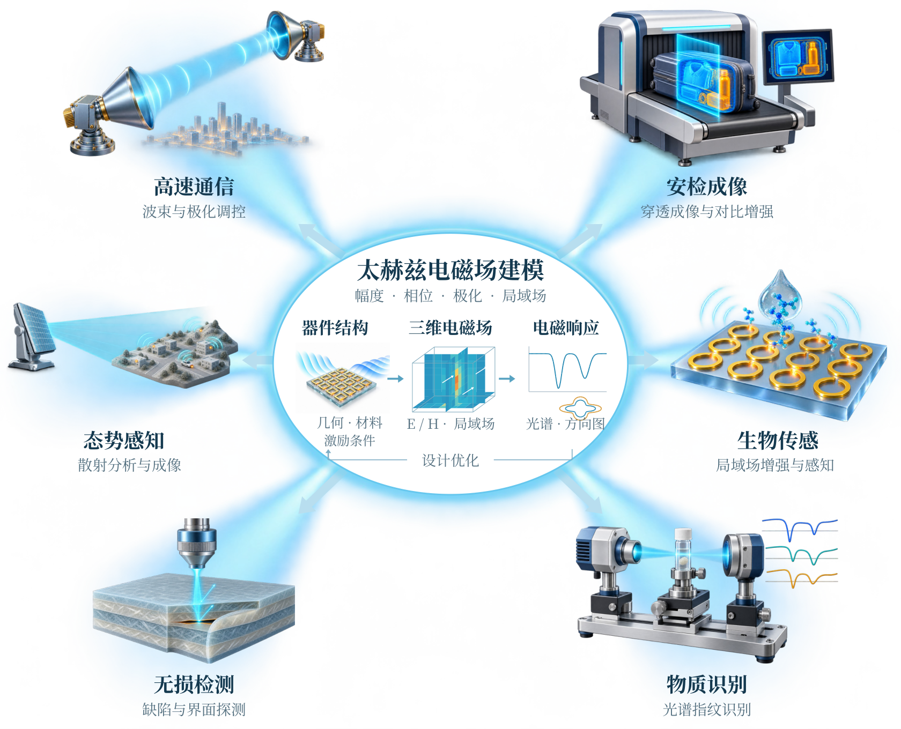
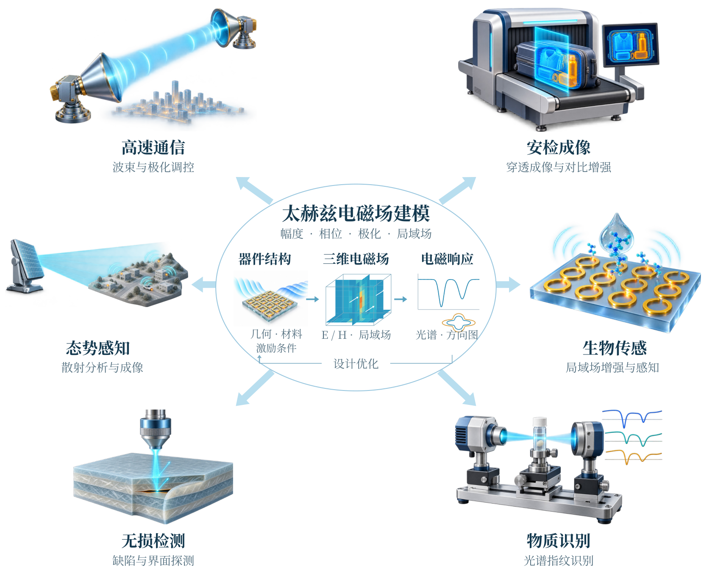
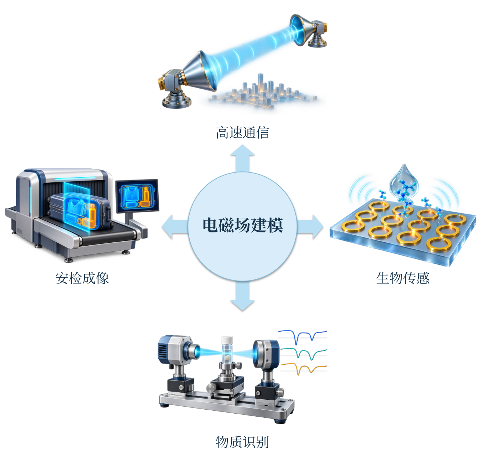

# 图一：太赫兹领域中的电磁场建模应用

## 第四版：中心发光与六向照射

在第三版六类应用布局上，为中心建模区增加柔和青蓝光晕，并以六道向外展开的光束连接应用子图。原有文字、子图和科学关系保持清晰；第三版和更早版本均保留。

- [高清PNG（300 dpi）](https://github.com/TuTruntu/20261022-/raw/refs/heads/main/downloads/figure1_v4.png)
- [可编辑PPTX](https://github.com/TuTruntu/20261022-/raw/refs/heads/main/downloads/figure1_v4.pptx)
- [PDF](https://github.com/TuTruntu/20261022-/raw/refs/heads/main/downloads/figure1_v4.pdf)
- [SVG](https://github.com/TuTruntu/20261022-/raw/refs/heads/main/downloads/figure1_v4.svg)
- [第四版完整压缩包](https://github.com/TuTruntu/20261022-/raw/refs/heads/main/downloads/figure1_v4.zip)

光效用于强调中心建模对六类应用的支撑联系，属于概念性视觉表达。

## 第三版：六类应用与器件—场—响应关系

采用六向辐射布局，增加“无损检测”和“态势感知”；每个场景补充一条电磁建模作用短语。中心展示“器件结构 → 三维电磁场 → 电磁响应”，并以“设计优化”回环联系结构调整。保留正文插图风格，第一、二版均保留。

- [高清PNG（300 dpi，可直接插入正文）](https://github.com/TuTruntu/20261022-/raw/refs/heads/main/downloads/figure1_v3.png)
- [PDF](https://github.com/TuTruntu/20261022-/raw/refs/heads/main/downloads/figure1_v3.pdf)
- [可编辑PPTX](https://github.com/TuTruntu/20261022-/raw/refs/heads/main/downloads/figure1_v3.pptx)
- [SVG](https://github.com/TuTruntu/20261022-/raw/refs/heads/main/downloads/figure1_v3.svg)
- [第三版完整压缩包](https://github.com/TuTruntu/20261022-/raw/refs/heads/main/downloads/figure1_v3.zip)

建议图题：**图1 太赫兹电磁场建模的典型应用及其与器件设计的关系（概念示意）。**

场景、中心场切片和响应曲线均为定性概念示意，不是测量或数值仿真结果。原生文字、连接、中心场切片和响应曲线可在PPTX中编辑。

## 第二版：正文放射结构配图

按用户参考图采用“中心圆＋四向箭头＋四张应用子图”。中心为“电磁场建模”，四周为“高速通信、安检成像、生物传感、物质识别”，均对应最新申请书需求分析。不使用PPT制作skill，没有演讲大标题、编号、分栏或结论条。第一版保留在下方。

- [高清PNG（300 dpi，可直接插入Word）](https://github.com/TuTruntu/20261022-/raw/refs/heads/main/downloads/figure1_v2.png)
- [PDF（保留文字和箭头矢量）](https://github.com/TuTruntu/20261022-/raw/refs/heads/main/downloads/figure1_v2.pdf)
- [SVG](https://github.com/TuTruntu/20261022-/raw/refs/heads/main/downloads/figure1_v2.svg)
- [可编辑PPTX](https://github.com/TuTruntu/20261022-/raw/refs/heads/main/downloads/figure1_v2.pptx)
- [第二版完整压缩包](https://github.com/TuTruntu/20261022-/raw/refs/heads/main/downloads/figure1_v2.zip)

建议图题：**图1 电磁场建模在太赫兹领域中的应用（概念示意）。**

四张独立子图为生成的科研概念示意，非实验照片、实测或仿真结果；不表达定量光谱、穿透、传感或通信性能。中心、箭头与中文标签可在PPTX中编辑；正文使用建议选择高清PNG或PDF。

## 第一版：需求叙事图

- [下载 PowerPoint（图一.pptx）](https://github.com/TuTruntu/20261022-/raw/refs/heads/main/downloads/figure1.pptx)
- [查看高清图片](figure1.png)
- [下载 PDF](https://github.com/TuTruntu/20261022-/raw/refs/heads/main/downloads/figure1.pdf)
- [下载 ZIP 压缩包](https://github.com/TuTruntu/20261022-/raw/refs/heads/main/downloads/figure1.zip)

点击 PPT 下载链接后，可将文件保存到桌面。英文文件名用于兼容下载；下载后可重命名为“图一.pptx”。

本图依据2026年10月22日最新申请书制作，按“应用牵引 → 亚波长器件与场响应 → 建模瓶颈 → 研究需求”展开。文字、箭头、应用场景与瓶颈图形为原生可编辑元素；中央器件为概念渲染图。所有波纹、热点和网格均为概念示意，不代表测量或仿真数据。
