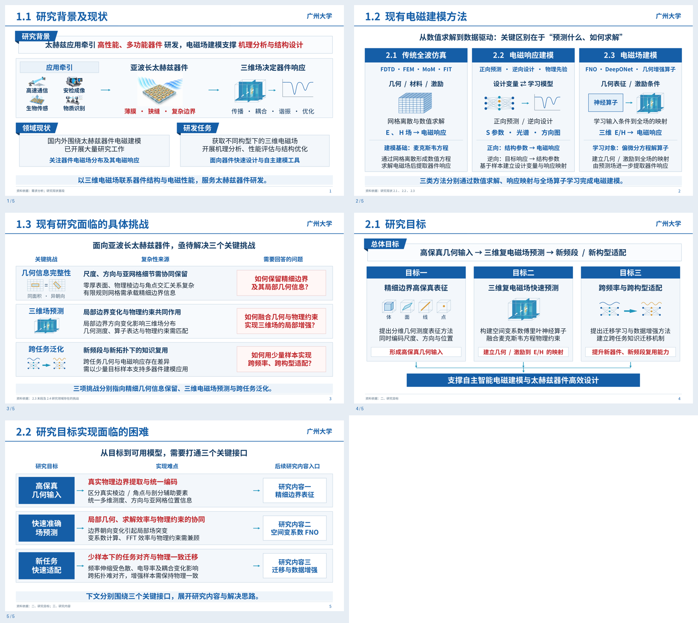

# 太赫兹项目：研究背景、现状与目标（5页修订版）

- [下载修订版可编辑PPTX](https://github.com/TuTruntu/20261022-/raw/refs/heads/main/downloads/presentation_5slides/thz_background_objectives_5slides_revised.pptx)
- [查看修订版PDF](thz_background_objectives_5slides_revised.pdf)
- [下载修订版完整压缩包](https://github.com/TuTruntu/20261022-/raw/refs/heads/main/downloads/presentation_5slides/thz_background_objectives_5slides_revised.zip)

| 页 | 标题 | 内容依据 |
| --- | --- | --- |
| 1 | 研究背景及现状 | 需求分析、研究现状首段；仅背景、领域研究积累与研发需求 |
| 2 | 现有电磁建模方法 | 2.1、2.2、2.3；仅方法原理、代表形式及输入输出 |
| 3 | 现有研究面临的具体挑战 | 2.3末段、2.4；集中讲三项挑战，不重复方法介绍 |
| 4 | 研究目标（保持原版） | 二、研究目标 |
| 5 | 研究目标实现面临的困难（保持原版） | 二、研究目标；三、研究内容 |

本次消除前三页重复：第一页不列具体方法和弊端，第二页不列挑战，第三页只讲挑战。第四、五页与原版逐字节比对确认未改动。只有这五页，没有封面或额外研究内容页。第三页讨论领域科学挑战，第五页讨论本项目的实现接口，衔接用户已有的研究内容介绍。文字、流程、表格式框架与科研小图均为原生可编辑对象；首页应用场景及器件图片是独立资产。

原版文件仍保留，文件名不含 `_revised`；以上下载链接均为本次修订版。

内容依据本轮上传《太赫兹国重申请书-汇总-10-22.docx》，未使用上一版Word代替。每页备注包含对应章节、提炼原则和来源信息。所有场图、曲线和应用场景都是概念示意，不是实验或仿真结果；没有把拟达指标或文献性能当作项目已取得的成果。

**模板说明：**《广州大学-张珍TZ4.pptx》超过当前文件工具32MiB传输上限，无法读取。本稿按用户提供的“1.1立项依据与研究现状”截图重建蓝白配色、页眉横线、蓝色缎带和框式布局，尚未套用原PPT母版。未复制示例中的“像素答辩”标志或不相关申报政策文字。

工作流参考已下载的 [scientific-slides skill](https://github.com/K-Dense-AI/claude-scientific-skills/tree/593377bb048752abb0152deab9fbb1083a6087df/skills/scientific-slides)，来源为K-Dense，MIT许可；来源版本记录保存在本地仓库 `skills/pptx/UPSTREAM.md`。此处不引用尚未独立核验的技能论文。
